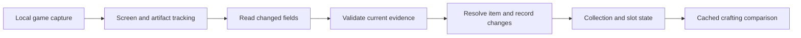

# Passive artifact tracker: plan for world-class reliability

Date: 2026-10-16  
Status: Initial video baselines recorded; category-line capture, dim signed-percentage improvements and shared stat context are implemented locally. Verification uses the saved before reports and separate after reports. These video-driven increments are not yet committed; the earlier scanner improvements are backed up on `backup/scanner-dice-2026-10-15`.
Scope: One continuous observer for crafting, owned artifacts, upgrades and equipped slots, with shared recognition and scoring across both scanner layouts. The user's target is automatic collection maintenance and immediate crafting guidance while playing normally.

## Intended experience

Start a capture session, then play normally. The observer finds supported artifact screens, follows their fields through movement and animation, and builds the collection without per-item Read, Keep, category selection, field calibration or data entry. Crafting and storage layouts are detected automatically. Existing manual controls become optional recovery/debug tools rather than prerequisites for ordinary use.

For an owned artifact, the observer captures the full visible item, recognises whether it is a new physical copy or an existing one, and records changes to that same item. Upgrades, unlocks, rerolls and observed equipment moves update its history and scores. Observed loadout screens establish which items occupy which slots. Crafting produces a prominent Red/Amber/Green result using the current profile, scoring rules and collection.

When a field is briefly obscured or dim, retain the readable fields and retry the uncertain field from subsequent frames. A pending observation can persist without interrupting play. Do not require a form to continue. A field that remains unreadable stays unknown; historical data must not be presented as a newly verified current value. Preserve a clearly marked previous result while the current artifact is being read.

The goal is a substantial practical improvement in speed, completeness, and reliability. Success is measured by complete artifacts and correct decisions, not a particular speed multiplier or an average character-recognition score.

## Product contract and boundaries

"Knows it has everything" means that each required field has current, non-conflicting evidence and the screen/layout is understood. Required fields vary by layout: five or six ordered perk rows, names, signed values, visible upgrade levels, unlock states, category, Hall and visible dice controls; owned-item title and identity; equipment location only where the screen actually reveals it. Keep separate statuses for complete item capture, resolved physical identity, confirmed ownership and known slot. An item can have complete stats while its slot remains unobserved.

The collection contains observed owned artifacts, not every artifact ever seen. A crafting result is initially a candidate in the crafting log. Promote it to owned only after a verified retention transition or later owned-item observation; a sell prompt alone is not proof of sale. Do not add a craft to its own comparison benchmark. Keep partial collection coverage visible: completing one artifact does not establish that every artifact in the account has been seen.

Slots must come from observed loadout positions, selected loadout/preset context, reliable in-game indicators or verified equip/swap transitions. A standalone item dialog, a perk pattern, or a tile's position in a sortable inventory cannot establish its equipped slot. Unseen slots remain unknown, and returning to a familiar item preserves its last verified location with an observation timestamp. The observer watches the game; it does not equip, sell, upgrade or reroll on the player's behalf.

Two copies with identical visible details cannot always be distinguished from one isolated image. Preserve that uncertainty and their possible multiplicity instead of merging them by appearance or inventing a new copy on every visit. Recover identity from navigation, slot context, an observed transition or later distinct evidence; exceptional unresolved cases may offer an optional confirmation. No promise of universal identity resolution from pixels alone.

## Continuous reading and capture architecture

Run cheap visual detection/change checks continuously. Keep OCR workers warm, prioritise the current artifact, and read only new or changed fields. Cancel obsolete work rather than queueing whole-screen OCR. The category line needs its own location, independent of wrapped titles. Signed numbers and perk names need separate validation; stars, dice and Hall colour use visual evidence. Reuse verified fields within the same encounter, but never join different artifacts or retain a changed value as current. Use additional frames to corroborate uncertain text without treating repeated identical pixels as independent evidence.

An automatic layout/field detector must remove the current dependence on user-selected boxes. Calibrated geometry can remain an optimisation/fallback, but passing a replay with manually supplied game bounds does not prove this detector works. Compare a candidate OCR engine only after field extraction and tracking have been measured; select it on exact direct reads and latency on real held-out gameplay, not a generic engine ranking.

Before implementation depends on browser-only capture, run an early feasibility check with the game focused, the scanner behind it, window movement/resizing, capture loss/reconnect and an ordinary-length session. The current capture controller explicitly marks hidden-page monitoring unconfirmed. The target experience requires reliable processing while the user plays, plus a small visible status/result display that does not intercept game input.

A browser capture session still needs the user to select/authorise sharing at its start; that permission cannot be silently reused for a later capture request. See [MDN getDisplayMedia](https://developer.mozilla.org/en-US/docs/Web/API/MediaDevices/getDisplayMedia). If the browser path cannot meet background processing or result-display targets, use a small local Windows companion for capture/processing and a compact overlay, keeping the collection/scoring model shared with the site. [Windows Graphics Capture](https://learn.microsoft.com/en-us/windows/apps/develop/media-authoring-processing/screen-capture) provides a native window/display capture route; a prototype must validate it on this game and laptop before committing to that architecture. Screen reading remains local. A native helper is not permission to read game memory or control the game.

## Artifact identity, duplicates and upgrades

Each physical artifact needs its own persistent local ID. Observations, changing stats and locations attach to that ID; the current OCR text/hash is an observation signature, not the item's identity. Capture session/encounter IDs also remain separate from persistent item IDs.

| Observed event | Required behavior |
| --- | --- |
| Same owned item, same fields | Refresh last-seen evidence; no additional copy or repeated item-log entry |
| Same owned item, one perk upgraded | Update that item's value/level and history; keep its ID and verified slot; recompute affected totals/cutoffs |
| Stars unlocked or reroll availability changed | Update those fields on the same identified item without fabricating another artifact |
| A perk is rerolled during continuous observation | Record the changed physical row as a revision of that item, retaining the prior perk in history |
| Another copy with the same title | Keep a distinct instance when navigation/count/slot evidence establishes another physical copy |
| Several existing copies fit a returning observation | Save an unresolved observation; do not choose the first matching database row or duplicate the collection |
| Equip/swap is visibly completed | Update the affected slots together; remove the old assignment only with observed replacement evidence |
| Item is absent from the current view | No automatic deletion or unequip; this is incomplete coverage, not a sale |
| Sale/retention is verified | Apply the observed ownership transition to the resolved instance; retain revision history |

Match using title, Hall/category, ordered perk identity and verified base/tier evidence, supported by continuous navigation and location. An upgrade changes current value and level, so an exact current-value signature must not be the only identity test. A base/tier fingerprint helps rank candidates but is not unique: genuine duplicate copies can share it, and rerolls can change it. Preserve duplicate physical rows and avoid assigning an upgraded row to its identical neighbour without sufficient evidence.

For example, an observed `+6%, level 1` row becoming `+7%, level 2` on the continuously tracked item updates its existing record. If the player returns later and two copies could have produced that change, hold the observation until identity resolves. Increasing percentages alone does not prove an upgrade or an identity match; signs, levels and in-game context must agree.

Persist accepted updates atomically with before/after values, timestamps and evidence sources. Make automatic revisions reversible and keep profile boundaries explicit. Late OCR from a previous encounter/profile cannot overwrite the current item. A weaker observation must not replace a verified field; a real observed change creates a new revision and invalidates relevant score caches. Existing collection IDs, manual data and slot assignments need a migration that preserves them.

The current importer already merges some reviewed upgrades by matching base ranges. It also uses the first matching candidate and requires reviewed imports. That is a useful foundation, not sufficient physical identity or automatic collection synchronisation for identical copies.

## Crafting Red / Amber / Green

| Result | Meaning |
| --- | --- |
| Green | Confirmed keeper under the existing keeper rule, or a sufficiently verified craft that beats the configured owned-item cutoff |
| Amber | No dependable keep/discard conclusion yet: incomplete/contradictory reading, uncertain reroll potential, missing benchmark context or an underfilled comparison group |
| Red | Verified result does not improve the relevant cutoff, including ties, and no keeper exception applies |

Preserve the current same-category, same-Hall comparison, active profile/role ratings, maximum-potential scoring, best eligible reroll and top-two rule. Do not introduce a new subjective quality threshold as part of OCR work. Keep the explicit three-unlocked-stat auto-keep exception: verified stars may justify an early green with that reason even while other fields are pending, but it must not claim a complete stat capture or a confirmed numerical comparison.

Show a short reason such as `KEEP: 3 open stats`, `Above your second-best Armor`, `Below your cutoff`, or `Reading row 4`. The visible result must refer to the current encounter. OCR failure cannot produce red; an old green cannot remain presented as the new item's decision. Collection uncertainty that could change the verdict keeps it amber. Optional details can show score, cutoff, capture completeness and the best reroll without making the main result busy.

Target a correct current result in roughly 300-500 ms after the first fully readable frame when warm, with the 95th percentile below one second. This is a measurement target, not an achieved promise. Report time to full capture separately from time to a valid early keeper exception. Collection/profile/slot updates refresh comparison context immediately using cached scores; they must not require rescanning the entire collection.

## Delivery sequence

1. **Establish the unattended capture path and evidence.** Test foreground-game/background-scanner behavior now, annotate encounter boundaries, and add upgrade, reroll, identical-copy, equip/swap and retained/sold-craft recordings. The existing clip establishes the first reading baseline, not all these transitions.
2. **Deliver automatic complete reads and fast crafting guidance.** Detect layouts/fields without manual boxes; fix category tracking and dim signed values; assemble and verify current fields; display current R/A/G against the existing collection. Prove speed and direct completeness through timed replay before enabling unattended inventory changes.
3. **Maintain owned items automatically.** Add physical instance identity, persistent evidence/revisions, duplicate handling, verified automatic create/update, and recovery of incomplete observations. An upgraded owned item must update its existing record without a Read/Keep action.
4. **Synchronise equipped slots and ownership transitions.** Observe loadouts and equip/swap/retention/sale outcomes; preserve instance assignments across upgrades; separate unknown slots from known unused items. Validate these changes end to end with real game transitions.
5. **Tune and validate on unseen play sessions.** Benchmark recognizers where needed, calibrate acceptance, verify longer background sessions and recovery, and measure collection/slot correctness as well as R/A/G speed. Release only with documented remaining limits and a reversible data migration.

## First implementation increment

Implemented locally: automatically isolate the crafting category line, including below wrapped titles, and separate its text from the adjacent icon before OCR. Title-sized or too-distant header text cannot stand in for a missing category. Confidence thresholds, signed-stat rules, keeper rules and ownership/import behavior remain unchanged. This is a focused reading improvement that removes a common reason for selecting the category manually; it does not yet deliver unattended collection updates.

On the first 24 labelled development-video frames, category correctness improved from 4/24 to 24/24 and all labelled visible fields correct improved from 3/24 to 12/24. Stat extraction itself remained 12/24 direct complete sets; the ten storage samples retained their previous results. The timed replay improved from 18 to 20 encounters with completed reads, and from eight to nine encounters with entirely direct stat sets. Saved after measurements and remaining gaps are in [the implementation report](../reports/scanner-category-improvement-2026-10-16.md), separately from the initial baseline. These are same-session development results, not held-out accuracy guarantees.

## Second implementation increment

Implemented locally: separate coloured names and signed numeric suffixes within overlapping crafting fields, magnify and normalise dim numeric imagery, and retain earlier readable fields when a retry is incomplete. Original confidence and conflict checks remain intact. On the same development frames, entirely direct name/value sets improve from 12/24 to 23/24, with no loss among previously correct items. Category correctness remains 24/24; row-reader-valid results increase from 3/24 to 9/24. The ten storage samples retain their previous results.

Median read duration falls from about 928 ms to 710 ms in the diagnostic still-frame run. In timed replay, encounters with entirely direct matching stats increase from 9/24 to 21/24; row-reader-valid encounters increase from 3/24 to 8/24, with no valid incorrect stat sets in this sample. This excludes real capture and is not proof of the live latency target. The very dim Bronze Helmet row still fails, two encounters have no associated completed read, and many correctly read items still require review. See [the percentage implementation report](../reports/scanner-percentage-improvement-2026-10-16.md) for complete/direct/accepted counts and regression evidence.

The existing screenshot regression audit also passes: all 66 image/scale cases have direct, correct stat sets, 65 are confirmed, and none is confidently incorrect. The cases represent 22 source screenshots at three scales, not 66 independent artifacts.

The next implementation should establish the foreground-game/background-observer capture path and explicit encounter boundaries, then retain and retry only uncertain fields from the current item. This connects the reading gains to passive use. Physical item identity and reversible automatic collection writes follow that foundation; slot synchronisation follows observed loadout/equip evidence. A correct colour-based inference remains separate from a successful numeric read.

## Stat-context foundation

The user's request to use known signs, tiers and browser observations now has a first implementation: a generated database of 201 existing stat identities, 200 known signs, scoped ordinary tier/level rules, reviewed aliases, positive ordinary availability evidence for 95 Main and 13 War stats, and separate named-artifact examples. Both scanner pages attach this context to completed readings. A candidate resolver can distinguish a legal observed value from an incompatible one while preserving the original OCR and review state.

Browser history remains supporting evidence. A new local stat-evidence export reads saved crafting observations and owned inventory without changing them; unknown strings and repeated OCR readings do not become confirmed rules. The existing October 14 export has 345 scans and 128 logged items. The current browser session has not been directly inspected.

The next step for this foundation is to use scoped candidate constraints during uncertain-field retries, then calibrate when independent name/Hall/tier evidence justifies accepting a deduction. Keep context-resolved values separate from direct reads. Do not remove wrong-sign, colour, item-type or upgrade-level conflicts to improve acceptance counts. The latest green-War example conflicts with the saved War green/blue mapping and remains an open clarification. Full details and verification are in [the stat-context report](../reports/scanner-stat-context-2026-10-16.md).

The [new full-log review](../reports/scanner-full-item-log-2026-10-16.md) examines 176 historical Main crafting encounters and 489 reads. It reveals 205 inferred values, including 31 based on assumed names, 79 missing categories, and a later conflicting `-5%` retry displacing an earlier `-6%`. Local fixes retain the earlier better item record, refuse to derive missing numbers from an assumed identity, and report final-item inference separately from raw OCR passes. Of 76 missing numeric values, 75 also lack a confident name. Explicit read-to-encounter links and retention of independently supported fields are therefore the next useful foundation; metadata cannot replace missing identity evidence. Repeated signatures remain review candidates, not automatic merges, and this older export does not measure today's reading accuracy.

Late replay checks also expose a live-throughput concern: 10/24 direct encounters in production and 11/24 in an isolated old-inference control, with higher scheduling lag than the earlier 21/24 run. Neither has a valid incorrect stat set. The control does not isolate every previous change or host load; stabilize and profile the live capture/read path before treating the earlier coverage/speed result as preserved. Saved earlier measurements remain historical evidence, not an unconditional current guarantee.

## AI accuracy benchmark and realistic scope

Use a strong vision reader as an additional contender on the same independently checked, held-out artifact encounters. Compare whole-item exactness (all required visible fields), direct versus inferred values, wrong acceptance, resulting R/A/G, latency including retries/startup, and resource/cost constraints. Save the model/version, prompt and structured output so the result can be reproduced. Model output must be checked against reviewed labels rather than becoming its own ground truth. This model comparison has not been run yet.

A vision reader that excels at paused screenshots establishes an accuracy benchmark for the text-reading stage. The live system must also meet encounter, identity, persistence and slot correctness targets at natural navigation speed. If a more capable reader is too slow for every item, measure it as an uncertain-field fallback while the fast local path handles ordinary views.

The practical first release should automate clear, supported dialogs, retain partial evidence through brief interruptions, and recover missing fields on subsequent frames without routine forms. Increasing the number of those encounters completed directly and promptly is measurable progress. A screen observer cannot recover fields never shown, prove an unobserved slot, or always distinguish physically identical copies from an isolated image. Report those cases and expand supported coverage rather than declaring universal recognition from a good screenshot score.

## Passive Storage Scanner increment

Implemented locally after the reading/context work: Storage edits apply immediately; complete new items save to scanned inventory without Read/Keep confirmation, identical saved stats are skipped, and unique non-regressing upgrades update the owned Collection record directly. Existing IDs and slots survive; previous rows are retained as revisions. New scanned inventory still transfers to Collection through Add Inventory to Collection. Several matching copies remain unresolved rather than selecting the first candidate. This follows the user's explicit request for passive saving; it does not prove physical identity between identical-looking copies.

Automatic persistence rechecks the current profile's Collection and scanned inventory in one transaction. Missing/conflicting fields block saves. Manual edits wait 650 ms before saving, preserving input focus and avoiding first-digit writes; complete OCR reads need no editing delay. Navigation, invalid edits and profile changes invalidate queued saves. Failed writes keep the visible fields and offer Retry Save. A correction to the newly staged item in the same encounter revises it instead of adding another copy. Batch transfer also preserves stronger owned versions.

The `--storage-passive`, `--storage-layout` and `--inventory-tiers` browser checks cover this behavior with real DOM/IndexedDB and controlled OCR. These are functional checks, not held-out OCR, background capture or universal identity evidence. Automatic layout discovery, field tracking/retry, background feasibility, stronger instance identity and observed slot synchronization remain outstanding.

## Current foundation

The October 16 implementation provides:

- Batched OCR of calibrated fields, with physical row association that preserves omissions and duplicates.
- A pinned local fast English model, the original model for difficult-read fallback, model warming during capture stabilization, and separate caches for public model assets.
- Focused row/percentage retries and retained raw batch, guide, and field evidence.
- Cached owned-collection benchmarks and active rating lookups, with collection/profile/rating invalidation.
- Exclusion of assumed names, inferred percentages, and conflicting fields from complete crafting comparison totals. Readable rows can still produce a labelled subtotal.
- Regression coverage for signs, row positions, scoring, profile changes, correction, cancellation, capture cleanup, and both worker lifecycles.

Recorded measurements:

| Measurement | Result | Boundary |
| --- | --- | --- |
| Warm calibrated OCR across eight matched screenshots | 5,206 ms before; 1,044 ms after, approximately 5x faster | Excludes capture stabilization, model startup, and UI rendering |
| OCR calls across those eight screenshots | 137 before; 12 after | Aggregate, not calls per artifact |
| Repeated collection comparison | Approximately 225x faster | Synthetic 500-item collection; excludes OCR and capture |
| Expanded screenshot audit | 66/66 final name/value sets match labels | 22 source screenshots at three sizes; resized images are not independent examples |
| Direct extraction and review | 61/66 runs read all five percentages directly; 60/66 confirmed | Five runs still infer one percentage; one further run has contradictory evidence |

No confidently incorrect result was observed in that audit. Most source screenshots omit category/Hall pixels, and frozen-image tests do not establish live accuracy, transition handling, or complete-metadata accuracy.

Evidence: [OCR measurements](../reports/scanner-crafting-performance.json), [comparison measurements](../reports/scanner-comparison-performance.json), [recognition review](scanner-recognition.md), and [comparison behavior](scanner-comparison.md).

## Proposed acceptance targets

These are initial targets to validate on agreed hardware, resolutions, layouts, and navigation speeds. They are not achieved guarantees.

| Measure | Initial target | Definition |
| --- | --- | --- |
| End-to-end latency | Typically 300-500 ms; 95th percentile below one second | First frame on which the artifact is fully visible and readable to the correct current result being rendered; includes detection, stabilization, OCR, validation, comparison, and rendering |
| Complete automatic correctness | Above 99% | All required visible fields correct, current, and captured without inference or manual correction, divided by eligible artifact encounters |
| Wrong automatic acceptance | Below 0.1% | Incorrect automatically accepted complete results divided by all automatically accepted complete results |
| Manual review frequency | Below 1% in ordinary supported conditions | Eligible encounters requiring user correction or remaining incomplete; report missed encounters separately |
| Stale decisions | Zero in the transition regression suite | An old or mixed-artifact result must never be presented as a confirmed current decision |
| Routine per-item interaction | Zero after session capture starts | Supported readable encounters require no Read, Keep, field selection or data entry; unresolved observations persist without blocking play |
| Instance identity and upgrades | No false merges, lost copies or duplicate inflation in the reviewed identity regression suite | Same-instance revisits/upgrades/rerolls, distinct identical copies and ambiguous returns have separate labels; report resolved coverage and errors on held-out encounters |
| Observed slot correctness | Above 99%, with unknown and stale assignments reported separately | Correct artifact-instance-to-slot assignments divided by labelled slot observations; never count an unseen slot as verified |
| Background session reliability | Pass a 60-minute foreground-game/background-observer run on the target laptop | Capture, OCR, persistence and current result remain responsive through window movement and reconnect; report missed encounters, latency and resource use |

Report cold-start/model-load time separately. For rapid navigation that never exposes a readable artifact long enough, record a missed/too-brief encounter instead of silently excluding it from the navigation report.

Complete capture includes all five/six perk names and signed percentages, star states, category, Hall, visible upgrade levels where present, and visible dice controls. Owned-item titles, physical identity, ownership and location each have their own correctness checks. Preserve locked rows and duplicate perks. Distinguish pixel evidence from manual input, rule-based eligibility, inferred values and previously verified historical fields. Existing explicit keeper/scoring rules must be tested separately from complete-capture accuracy.

A confidence score or agreement between recognizers does not prove these targets. Establish them using independently checked labels, held-out sessions, documented denominators, and uncertainty intervals. Thousands of independent encounters will be needed to substantiate a rare-error target; frames or resized copies of the same artifact do not increase that independent sample count.

## Milestone 1: gameplay evidence and repeatable replay

The first recording is available: `2026-10-16 12-32-06.mkv`, 297.8 seconds, 3440 x 1440. Initial evidence and reproduction commands are in [the video review](../reports/scanner-video-2026-10-16.md); labels are in [the reviewed development set](../tests/scanner/video/2026-10-16.json). Original footage and frame images remain local.

Completed: full-video storyboard, 24 crafting and 10 storage labels, five interruption/non-artifact probes, SHA-256 verification, single-frame baselines through the production reading controller/scorer, and a timed crafting replay through automatic reading and logging. The replay exposes category omissions, dim signed-percentage failures, and encounters without completed reads. It bypasses the capture chooser and interactive calibration, using a manually selected game viewport and default crafting field boxes.

Still needed for a complete encounter-level evaluation: exact first-readable/last-readable boundaries, labels for the remaining stored items and the craft near 250 seconds, independently reviewed annotations, actual capture/calibration replay, stale/mixed-result and duplicate-log checks, and held-out recordings. Current read durations do not establish end-to-end latency. No War crafting appears in this recording; War storage does.

1. Preserve the original recording and capture metadata: resolution, frame rate, game/capture layout, scaling, and whether the scanner was visible alongside it.
2. Identify artifact encounters and transitions by timestamp. Include readable pauses, ordinary navigation, fast skips, returns to previous items, and interruptions.
3. Extract representative full dialogs and difficult field crops. Independently transcribe visible names, signs, numbers, category, Hall, stars, and dice. Mark truly unreadable or absent fields as such. OCR output must not supply its own ground truth.
4. Build a replay harness that feeds recorded frames through the production reading controller and scorer at recorded timing. Single-frame OCR checks remain useful, but cannot stand in for this replay.
5. Produce an encounter-level report: complete/direct extraction, field errors, missing artifacts, duplicate log entries, stale/mixed results, review rate, and latency percentiles. Break results down by colour, brightness, scale, layout, and transition type.
6. Separate development and evaluation recordings. Group repeated views of the same artifact together so tuning and evaluation do not share it. Reserve additional sessions and resolutions for final validation.

Recording guide: start with 2-5 minutes at normal game resolution, around two seconds per artifact plus some faster navigation. Keep the full artifact dialog visible and include varied colours, locked rows, duplicates, and categories. A side-by-side scanner view helps diagnose display errors if it preserves the game's usual text resolution. Use the original recording where possible.

Deliverables: local recording manifest, reviewed labels, replay command, baseline report, and a ranked failure list. Videos and extracted pixels remain local development evidence and outside the published site.

Exit condition: the replay reproduces observed failures and can compare a candidate change with the current scanner on exactly the same encounters.

## Milestone 2: capture, tracking, and current-artifact identity

Use the replay to determine how much failure comes from capture rather than OCR.

- Track the panel and field geometry through supported movement and resizing while preserving native text detail.
- Detect crafting, owned-item and loadout layouts automatically; locate fields without requiring the player to draw boxes or choose a mode. Verify the unattended background capture path before relying on browser-only processing.
- Detect readable/stable fields individually. Unchanged fields should not need repeated OCR, and changing fields must invalidate their previous evidence.
- Evaluate short frame bursts and aligned temporal evidence for animated or dim text. Do not combine different artifacts or manufacture stars/dice states through filtering.
- Make cancellation and encounter identity explicit: late results from another artifact, crop, session, or manual edit cannot update the current result or log entry.
- Reduce fixed waiting only where replay results show that latency improves without more missed or mixed reads.

Deliverables: measured capture/settling changes and regression sequences for animations, navigation, panel movement, capture interruption, and revisiting identical artifacts.

Exit condition: current-artifact tracking passes every reviewed transition sequence, and latency improves without reducing direct-capture correctness or increasing review frequency.

## Milestone 3: recognition suited to each field

Keep the current implementation as the measured baseline.

- Benchmark the current Tesseract paths and a modern dedicated text recognizer, such as [PaddleOCR](https://github.com/PaddlePaddle/PaddleOCR), on the reviewed game crops. Compare exact names, signed percentages, review frequency, latency, startup, memory, and local deployment requirements. No engine replacement is assumed in advance.
- Evaluate names separately from signed numeric suffixes. Signs, decimal points, and percent glyphs need explicit error analysis.
- Treat stars, dice, and Hall colour as visual classification tasks, with their own labels and checks.
- Use the perk catalogue to rank plausible spellings while preserving readable qualifiers and raw evidence. Unknown names remain observable candidates; they must not become a convenient known perk.
- Retry only uncertain fields with a useful alternative image treatment or recognizer. Agreement is supporting evidence; disagreements remain visible.
- Consider game-font training or synthetic examples only after the failure analysis justifies them. Tune on development data and evaluate on unseen real captures.
- Keep processing local. Compare browser/WASM/WebGPU and a local helper only if the measured candidate warrants the added deployment work. A cloud service would be a separate product decision.

Deliverables: per-field engine comparison, selected processing path, resource measurements, and reproducible difficult-crop regressions.

Exit condition: the selected path improves direct complete-artifact correctness or materially reduces review frequency, while meeting the agreed latency/resource budget and preserving sign/qualifier/scoring invariants.

## Milestone 4: confidence, correction, and trustworthy decisions

- Keep separate evidence for names, percentages, metadata, and visual controls. Name similarity is not the probability that a whole field is correct.
- Calibrate automatic acceptance using held-out labelled results. Report correctness among accepted results together with acceptance/review coverage; rejecting everything is not success.
- Show the particular uncertain field and its original crop/readings, with a quick correction path that retains other captured data.
- Retry uncertain fields automatically and persist pending observations; manual correction is optional recovery, not the normal path for saving an artifact or continuing play.
- Keep partial subtotals distinct from complete comparison decisions. Present unknown category/Hall and uncertain reroll availability explicitly.
- Validate the existing three-open-stat keeper exception separately so it cannot be mistaken for a fully read artifact or a score-based recommendation.
- Retain reviewed corrections as labelled development evidence. Do not automatically turn every runtime correction into a global alias or training label.

Deliverables: acceptance thresholds justified by evaluation results, field-specific review behavior, and correction/decision regression tests.

Exit condition: acceptance meets the measured error target at useful coverage, and users can distinguish a complete current result, a subtotal, a retained previous result, and an explicit keeper exception.

## Milestone 5: automatic owned collection and instance history

Introduce persistent physical item IDs, encounter observations and reversible revisions before enabling unattended inventory writes. Replace first-candidate merging with explicit unique/ambiguous/new-instance matching. Use the current reviewed-upgrade importer as a regression baseline and preserve the IDs already used by collection/loadout data.

- Accept a complete, verified owned observation automatically, without Read/Keep actions. Save incomplete observations separately and improve them on later visits.
- Repeated observations refresh the existing item. Verified upgrades, unlocks and continuously observed rerolls revise that item, invalidate scores and preserve its location/history.
- Handle genuine identical copies and ambiguous returns without inventing copies or merging them silently. Measure both correctness and how often identity remains unresolved.
- Bind writes to the originating profile/session, deduplicate retried persistence operations, retain before/after evidence, and reject late or weaker field updates.
- Distinguish a crafting candidate, a verified retained item, a viewed owned item and a verified sale. Disappearance from the screen alone changes none of those ownership states.

Deliverables: collection schema/migration, instance matcher, automatic persistence, history/undo, and labelled replay cases for revisits, upgrades, rerolls, duplicate copies, profile changes and interrupted writes.

Exit condition: the upgraded-stat example updates the same physical item without user interaction; the identity suite has no lost copies, false merges or repeated additions; ambiguous cases remain explicit without blocking play. Existing manual collection/profile/slot data survive migration and restore.

## Milestone 6: automatic equipped-slot and loadout synchronisation

Recognise supported loadout/Hall/exhibit screens and observe the relation between a displayed item and its actual slot. Track loadout/preset context where the game exposes it. Keep the same item ID through an upgrade or observed move, and apply verified swaps to both affected assignments together.

- Use visible slot context and completed equip/swap transitions; inventory ordering is not an equipped-slot identifier.
- Keep confirmed unused, unknown location and last-observed equipped location distinct. Reconcile later slot views rather than inventing an assignment when only an item dialog is visible.
- Apply ownership changes only with adequate observed outcome evidence. Do not remove an item because it was absent from a partial inventory browse.
- Recompute affected collection totals and crafting cutoffs after verified item/loadout changes; the observer must not issue game actions.

Deliverables: loadout screen/slot detector, instance-to-slot association, consistent persistence, coverage/freshness indicators and replay cases covering equip, swap, revisit, sorting, upgrade-in-slot, duplicate copies and interrupted transitions.

Exit condition: labelled slot/ownership transitions reconcile automatically and survive restart; current stats remain attached to the correct physical item and observed location; unseen/ambiguous slots remain unknown. Report assignment accuracy separately from OCR and instance matching.

## Milestone 7: release gate and continuing evaluation

Validate the chosen implementation on held-out recordings and supported hardware/resolutions. Measure the entire capture-to-render path, including cold starts, longer foreground-game/background-observer sessions, memory bounds, automatic collection/slot/profile updates, and interruptions. Recheck both scanner layouts wherever shared code changed.

Before treating the targets as achieved, publish a local evaluation report containing the scope, independent encounter counts, denominators, confidence intervals, latency percentiles, direct/inferred/manual field counts, missed encounters, and remaining failures. Add every newly confirmed failure to the regression set without moving evaluation examples into development unnoticed.

Keep the current tested implementation available as a fallback if a candidate increases wrong acceptance, loses fields, or exceeds the resource budget. Future deployment remains a separate task from recording this plan.

## Immediate next action

Use the recorded failures in [the video review](../reports/scanner-video-2026-10-16.md) as the first development benchmark:

1. Verify capture/processing while the game has focus and the scanner is behind it; decide browser versus local companion from this test. Add labelled sequences for the user's upgraded-item example, identical copies and equipped-slot changes; the current recording does not establish those transitions.
2. Category-line tracking is implemented locally: 24/24 development frames now read the category, versus 4/24 initially. Verify it on unseen layouts and War crafting.
3. Dim signed-percentage extraction is implemented locally: all five names/values are direct and correct in 23/24 development frames, versus 12/24 initially. Preserve qualifier/sign evidence, duplicate physical rows and remaining weak-evidence review; validate on unseen play.
4. Reduce interrupted or uncompleted automatic reads using the timed sequence, and label the encounter boundaries before reporting capture-to-result latency or a definitive missed-encounter rate.
5. Calibrate field-specific acceptance on independently reviewed evidence. Storage read all 52 sampled name/value pairs correctly, but 9/10 items still triggered weak-evidence review. Do not remove review requirements simply to improve acceptance coverage.

Keep each candidate report separate from the baseline and rerun the same recording before broadening to another OCR engine. The initial evidence/replay work established the baseline; category-line capture and dim numeric extraction are the first two local production recognition increments.
